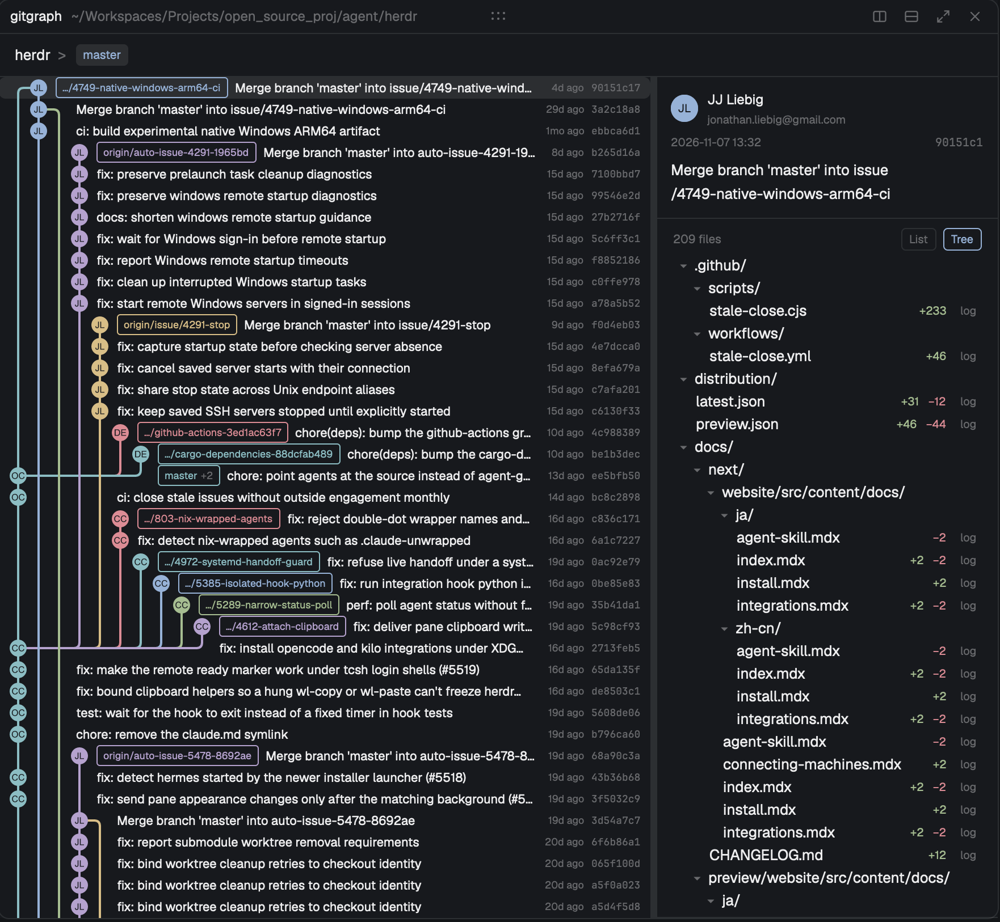
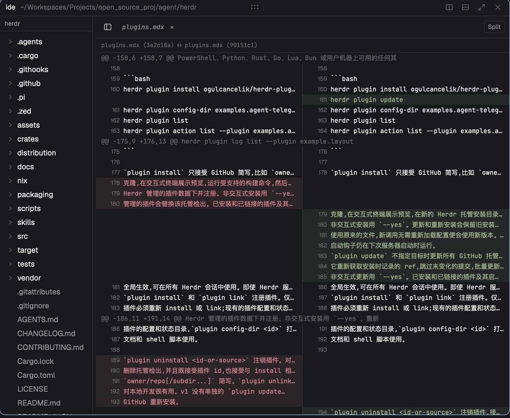

# herdr-gitgraph

A mod suite for the [Herdr](https://herdr.dev) app. It adds two panels to the terminal workspace:

- **gitgraph** — a commit graph with the repository's history, commit details, and the changed-file
  list (including uncommitted worktrees).
- **ide** — a file browser and editor in one pane, with diffs for files opened from the graph.

Both panels open like terminals and close like panes. Everything is read-only for git: history,
details and diffs come from `git log`, `git show` and `git status`, and no command writes under
`.git`.

## Everything is a panel

This suite replaces the editor-first workflow with panes. In VS Code the editor area owns the
center and other views — terminal, problems, source control, timelines — are docked to the edges;
a panel cannot take the editor's place.

In Herdr every surface is a pane. The commit graph, the file tree, the editor, a diff and the
terminals are all the same kind of object: split the workspace in any direction, put the file
view or the history graph in the middle, keep a diff beside the code it explains, and close or
move any of them like a terminal. That is the model this project is built for.





## Install

Requirements: the Herdr app (`herdr-app` on `PATH`), a git repository, and Node 20+ for the tests.
The mods need macOS or Linux; git must understand the repository you open.

```bash
git clone https://github.com/LitTTian/herdr-gitgraph
cd herdr-gitgraph

just sync     # copy every mod into ~/.config/herdr-app/mods
just layout   # install layout/ide.json and switch to it
just keys     # bind cmd-shift-g / cmd-shift-i, and ctrl-s inside the IDE
```

Without `just`, the steps are:

```bash
# mods
for m in gitgraph ide gitgraph-tabs ide-new-menu gitgraph-menu gitgraph-pane; do
  rm -rf "$HOME/.config/herdr-app/mods/$m"
  cp -R "mods/$m" "$HOME/.config/herdr-app/mods/$m"
done
# layout
cp layout/ide.json "$HOME/.config/herdr-app/layouts/ide.json"
herdr-app do layout.switch '{"name":"ide"}'
# keys
bash scripts/install-keys.sh
```

The layout uses the pane header from this repo (`gitgraph-pane`), so the folder of each panel
appears in the card header. Mods reload when their files change; reopening a panel picks up new code.

## Use

### Open a panel

- **+** button in the tab bar → **Open IDE here** / **Open GitGraph here** (splits beside the
  focused terminal).
- Right-click a terminal → **Open in IDE** / **Open in GitGraph**.
- Commands: `herdr-app do mod.open '{"name":"gitgraph"}'` or `{"name":"ide"}`.
- Keys: `cmd-shift-g` (gitgraph overlay), `cmd-shift-i` (IDE overlay).

A panel keeps the folder it was created with; moving focus between terminals does not change it.

### gitgraph

- Rows show the lane graph, branch badge, subject, relative time and short hash. 19 px tall.
- Branch tips carry a badge; several tips on one commit show the oldest branch and `+N`.
- Working-tree changes appear as dashed nodes. The checked-out branch's node has the current time,
  so it stays above every commit; each other worktree's node sits directly above its HEAD commit,
  linked to it by a dashed line. A node with changes carries a solid dot inside the dashed ring.
  The label is followed by `+added ~modified -deleted`, and the newest changed-file time is
  right-aligned like a commit's date (no hash). Clicking a node shows its path, branch, HEAD and
  files, the git identity configured for the project, and clicking a changed file opens it in
the editor. Other branches' lane lines run through
  these rows instead of being cut off.
- Lane 0 belongs to the checked-out branch only; commits outside its history never take it.
- The list pages 200 commits at a time; the next page loads when you reach the bottom.
- The right side shows the selected commit: author (avatar, name, email), date and hash, the
  Markdown message, and the changed files.
- Changed files switch between **List** (name first, folder after) and **Tree** (folders group the
  paths, single-child chains collapse like `src/app/widgets/`). `log` opens the file's history.
- Drag the divider between the list and the details, and the one above the file list.
- Narrow the panel below 600 px and only the graph column remains.

### ide

- The tree starts at the panel's folder; click a file to open it.
- A single click opens an italic **preview** tab that the next click replaces; double-click or start
  editing to pin it.
- Unsaved edits show a dot; the tab bar's **Save** button or `ctrl-s` saves the active file,
  `ctrl-shift-s` saves pinned dirty tabs.
- Clicking a changed file in gitgraph opens its diff here: in the IDE of the current tab, or in a
  new pane below when the tab has none.
- Diffs are tabs too: reselecting one reloads `git show`; switch between several without losing
  them.
- A Markdown file shows a **Source/Preview** switch at the top right; preview is read-only and
  reflects unsaved edits.
- Drag the divider to resize the tree; collapse it with the sidebar button.

### Layout

`layout/ide.json` is the shipped arrangement: spaces/agents sidebar, tab bar, terminals, status
bar. The tabs and menus are copies of the app's own, extended with the entries above (see
`NOTICE.md`). The panels are not layout blocks; they are opened on demand.

## Specs

The implementation follows these specs (SDD):

- [00 – Overview](specs/00-overview.md)
- [01 – Lane layout](specs/01-graph-layout.md)
- [02 – Commit list and paging](specs/02-commit-list.md)
- [03 – Commit details](specs/03-commit-details.md)
- [04 – Changed files](specs/04-changed-files.md)
- [05 – Opening a file](specs/05-diff-handoff.md)
- [06 – Pane header](specs/06-pane-header.md)
- [07 – Panel layout](specs/07-layout.md)
- [08 – Performance](specs/08-performance.md)

## Develop

```bash
just check     # node --test + herdr-app check for every mod
just sync      # mirror the mods into ~/.config/herdr-app/mods
just watch     # sync on file changes while developing
```

Git access is read-only: every command runs with `--no-optional-locks -c core.fsmonitor=false
-c diff.autoRefreshIndex=false`, so the folder watch never sees Herdr write under `.git`.

## Status

Implemented: the commit graph and the changed-file list, with commit details, paging, worktree
markers, and the editor integration needed to view a file's diff.

Not implemented yet: search, branch/tag management, remotes and fetch/pull/push, staging and
committing, commit actions (cherry-pick, revert, …), blame, file history browsing from arbitrary
refs, and settings.

## Known issues

- Under fractional UI zoom the graph can still be off by one pixel at some joints.
- Rows in the virtual list cannot hover-highlight: the app forbids item handlers there.
- A split pane's own header text belongs to the app; only the folder is supplied by this project.
- Avatars need network access; without it (or without a GitHub account) initials are shown.
- Paging loads only at the very bottom of the list.

## Acknowledgment

Thanks to the GitLens project (<https://github.com/gitkraken/vscode-gitlens>) for the reference
experience of the commit graph and the changed-file views. No code was copied from it.
